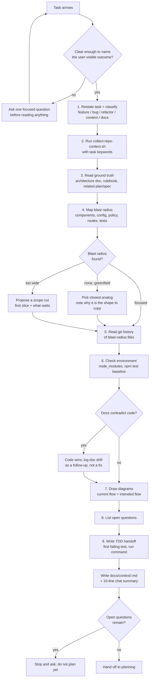
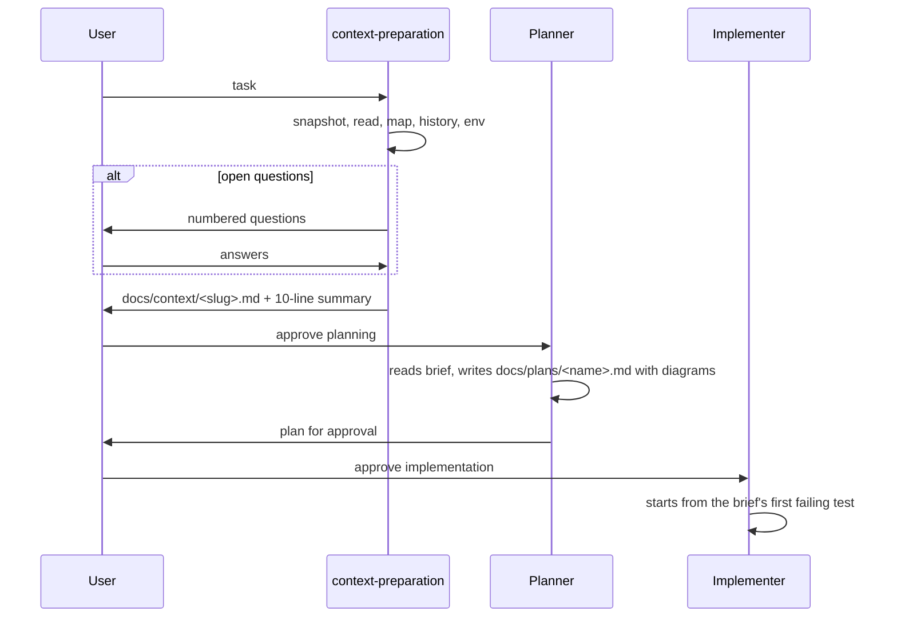

# Context preparation

Produce a **Context Brief**: a short, path-referenced document that tells the next agent (or the next turn of this one) exactly what the repository already decided, which files the task touches, what tests prove it works, and what is still ambiguous. Planning without it tends to re-invent conventions the repo already has, and the user has to spot the drift in review. Preparing the context first is cheaper than that.

The user is a visual thinker and works test-first, so the brief ends with diagrams and a TDD handoff. When something is genuinely ambiguous, the brief asks instead of guessing.

## Inputs and outputs

- **Input**: the task as the user phrased it, plus anything already known from the conversation.
- **Output**: `docs/context/<task-slug>.md` written from `references/context-brief-template.md`, and a 10-line summary in chat (goal, blast radius, open questions). Return the brief's path so the planner can read it.

A brief is a map, not a dump. Point at files; never paste their contents. Keep it under about 150 lines so it still fits beside a plan in context.

## Workflow



### 1. Restate and classify

Write the task in one sentence using the repo's own names (sections, components, routes). Classify it; the class decides where to look first:

| Class | Look first at |
| --- | --- |
| feature | the closest existing section or page, its config module, its policy object |
| bug | the component, its co-located test, the commit that last touched it |
| refactor | every importer of the thing being moved (`rg "from .*<Name>"`) |
| content | `app/config/*Configuration.ts`, `README.md` for the positioning copy |
| docs | `docs/architechture.md`, `docs/plans`, `docs/specs` |

If you cannot name the user-visible outcome, ask one question now. Reading the whole repo does not resolve an ambiguity that lives in the request.

### 2. Snapshot the repository

Run the bundled script from the repository root with two to five keywords drawn from the task (component names, route segments, domain words):

```bash
bash .claude/skills/context-preparation/scripts/collect-repo-context.sh SiteHeader navigation
```

It prints branch and recent history, package scripts, ground-truth documents, a source map with routes, the test inventory, environment readiness, and grep hits per keyword. It is read-only and deterministic, so it is safe to run as often as needed. Use its keyword hits as the seed for the blast radius; do not paste its output into the brief.

### 3. Read the ground truth

Always read, in this order, and record in the brief what each one settles for this task:

1. `docs/architechture.md`: phase boundaries, allowed technology, the no-CMS and no-Markdown rule for content, the "plan then wait for approval" mode of operation.
2. `.cursor/rules/es-lint.mdc`: the frontend rulebook. Policy values in `app/constants/policy.ts`, configuration in `app/config/*`, tests next to code, descriptive names, side-effect-free presentation components.
3. Any `docs/plans/*.md` or `docs/specs/*.md` whose name matches the task area. Prior plans carry decisions the user already approved.
4. Any earlier `docs/context/*.md` for the same area, so briefs stay consistent.

Read these files; do not rely on memory of them. They change, and a brief that cites a rule that no longer exists is worse than none.

### 4. Map the blast radius

For each keyword hit, open the file far enough to know its role (page, layout, feature component, atom, config, policy, test) and whether the task will edit it, read it, or create a sibling. Use Grep for importers so a rename or move does not miss a caller. Use an Explore subagent when the hit list exceeds roughly a dozen files; ask it for roles and importers, not summaries.

Edge cases, each with a specific response:

- **Nothing matches (greenfield)**: find the closest analog by shape, for example the newest homepage section for a new section, and say why it is the analog. The planner copies its structure, test, and config pattern.
- **Everything matches (too wide)**: propose a first slice that ships alone and lists what waits. Do not silently narrow; write the cut in the brief so the user can veto it.
- **Hits only in tests or docs**: the feature may already exist or have been removed. Check `git log -S"<keyword>"` before assuming it must be built.

### 5. Read the history

Run `git log --oneline -n 10 -- <blast-radius paths>` and open the two or three commits whose subjects explain a decision ("one nav row on desktop", "fix metric tile overflow"). Record the constraint each one reveals, not the diff. A reverted approach is the most useful line in this section because it stops the planner from proposing it again.

### 6. Check the environment

Note whether `node_modules` is present, run `npm test` once if it is, and record the baseline (passing count, or the first failure if any). A brief that says "tests pass" lets the TDD handoff start from green. If dependencies are missing, say `npm ci` is step zero; do not install on the user's behalf unless the task needs it now.

### 7. Draw the diagrams

Include at least two Mermaid diagrams: the current flow through the blast radius and the intended flow after the change. Use a sequence diagram when order or timing matters (scroll, video, async), a state diagram for breakpoints or toggles, a flowchart otherwise. Diagrams go in the brief, not only in chat; the planner reuses them.

### 8. List open questions

Anything where two readings lead to materially different work becomes a numbered question with both readings and the one the brief assumes. Routine calls (a name, a spacing value, which test file) are decided in the brief, not asked. If questions remain, the brief ends the turn; planning waits for the answers.

### 9. Write the TDD handoff

Name the first failing test (file, assertion in one sentence, and the smallest change that makes it pass), then the next one or two. Give the exact run command. This is the part of the brief the implementer reads first, so it must be concrete enough to start typing.

## Writing the brief

Copy `references/context-brief-template.md`, fill every section, and save it as `docs/context/<task-slug>.md`. The required section headings are:

`## Task`, `## Ground truth read`, `## Blast radius`, `## Conventions that apply`, `## History and rationale`, `## Environment and verification`, `## Diagrams`, `## Open questions`, `## TDD handoff`.

Creating `docs/context/` is documentation work and allowed by the architecture doc's "plan file (documentation only)" step; writing application code is not. The skill ends before any `app/` file changes.

## Handoff



Finish by printing the brief's path and the 10-line summary. If the user then asks for a plan, the planner reads the brief instead of re-exploring; if they ask to implement directly, start from the TDD handoff.

## Bundled files

- `scripts/collect-repo-context.sh`: read-only repository snapshot with keyword grep. Run it in step 2.
- `references/context-brief-template.md`: the brief's skeleton. Read it in the writing step.
- `evals/evals.json`: three realistic prompts for re-testing the skill after edits.
- `SKILL.test.ts`: vitest guards for the frontmatter, bundled files, and script output. Run with `npx vitest run .claude/skills`.
