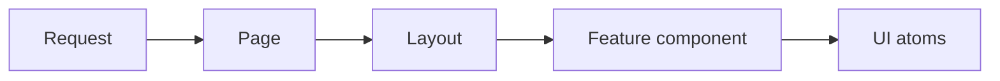

# Context Brief: <task title>

<!--
Save as docs/context/<task-slug>.md. Keep the whole brief under ~150 lines.
Point at files; do not paste their contents. Every claim should be something
the next agent can verify by opening the referenced path.
-->

**Date**: <YYYY-MM-DD> · **Branch**: `<branch>` · **Task type**: feature | bug | refactor | content | docs

## Task

One or two sentences restating the request in the repo's own vocabulary.
State the user-visible outcome, not the implementation.

**Done means**: <observable result, for example "the /work/pulseboard page shows a demo video with captions and `npm test` is green">

## Ground truth read

| Source | What it settles for this task |
| --- | --- |
| `docs/architechture.md` | <phase boundary, allowed tech, conventions that bind here> |
| `.cursor/rules/es-lint.mdc` | <rulebook lines that apply> |
| `docs/plans/<related>.md` | <prior decisions to respect, or "none"> |
| `docs/specs/<related>.md` | <spec constraints, or "none"> |

## Blast radius

Files the change will touch or must stay consistent with. Mark each one.

| Path | Role | Touch? |
| --- | --- | --- |
| `app/...` | <component / page / config / policy / test> | edit · read-only · new |

Closest existing analog to copy the shape from: `<path>` (why it is the right analog).

## Conventions that apply

- <Policy values live in `app/constants/policy.ts`; name the policy object this task extends.>
- <Configuration lives in `app/config/*`; name the configuration module.>
- <Tests sit next to the code they cover; name the test file pattern.>
- <Naming: descriptive, no abbreviations; propose the names you will use.>

## History and rationale

Recent commits on the blast-radius files and what they teach.

- `<short-sha>` <subject> — <the decision or constraint it reveals>

Doc drift noticed (code wins, docs get a follow-up note): <none | list>

## Environment and verification

- Install: `npm ci` (<present | missing>)
- Baseline: `npm test` → <passing count or "not run: <reason>">
- Lint: `npm run lint`
- Manual check: <page to open and what to look for>

## Diagrams

Keep the mechanism visible. Use Mermaid; the user is a visual thinker.

<One diagram of the current flow and one of the intended flow, or a sequence diagram when timing matters.>

## Open questions

Ask these before planning. Number them so answers can be short.

1. <ambiguity, with the two readings and which one the brief assumes>

If there are none, say "None; assumptions above are safe to proceed on."

## TDD handoff

The first failing test to write, then the smallest change that makes it pass.

| Order | Test file | Asserts | Makes it pass by |
| --- | --- | --- | --- |
| 1 | `app/.../<Name>.test.tsx` | <behaviour in one sentence> | <file and change> |
| 2 | ... | ... | ... |

Run with: `npx vitest run <test file path>`

Scope cut if the blast radius is too wide: <what ships first, what waits>.
